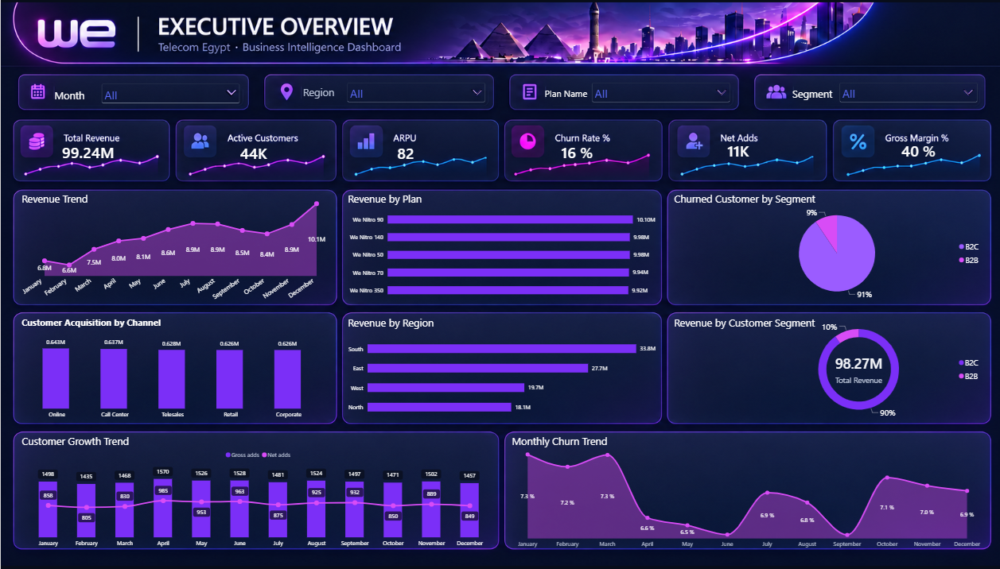

# WE Telecom | Business Intelligence Dashboard

## Project Overview
An instructor-guided Power BI training project focused on analyzing telecommunications business performance through an executive dashboard.

The project covers revenue performance, customer behavior, acquisition channels, and customer churn.

## Tools & Technologies
- Microsoft Power BI
- Power Query
- DAX
- Data Modeling
- Data Visualization

## Dashboard Features
- Total Revenue, Active Customers, and ARPU
- Customer Churn Rate, Net Adds, and Gross Margin
- Monthly revenue trends
- Revenue analysis by region and plan
- Customer acquisition and growth analysis
- Interactive filters for month, region, plan, and customer segment

## My Contribution
As part of instructor-guided training, I personally performed data cleaning and transformation in Power Query, created table relationships, wrote DAX measures, and implemented the Power BI dashboard.

## Dashboard Preview

## Project Note
This is an educational training project and is not an official report produced for WE Telecom.
